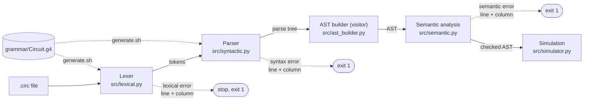

<div align="center">

# Circuit

A small language for describing combinational logic circuits.<br>Declare signals, write boolean equations, and get a lexer and parser with precise error positions.


[The language](#the-language) ·
[Install and run](#install-and-run) ·
[Pipeline](#pipeline) ·
[Precedence](#operators-and-precedence) ·
[Errors](#error-reporting) ·
[Interactive mode](#interactive-mode) ·
[Online](#online) ·
[Web interface](#web-interface) ·
[Tests](#tests) ·
[Status](#project-status) ·
[Specification](docs/specification.md)

<b>English</b> · <a href="README.pt-BR.md">Português</a><br>
<sub>Formal Languages and Compilers · semester project · by Lucas Leal and Jonas Gabriel</sub>

</div>

```bash
pip install -r requirements.txt && bash generate.sh && python src/syntactic.py examples/half_adder.circ
```

---

## The language

`Circuit` describes **combinational logic circuits** in text. A program names the circuit, declares its inputs, outputs and internal wires, and connects them with boolean equations built from the gates `AND`, `OR`, `NOT`, `XOR`, `NAND`, `NOR` and `XNOR`. The goal is a written, checkable way to specify a circuit, which later stages can simulate.

A half adder (`examples/half_adder.circ`):

```
// half adder: adds two bits
circuit "half adder";

input A, B;
output sum, carry;

sum = A XOR B;
carry = A AND B;
```

A circuit with a bus, indices and parentheses (`examples/bus.circ`):

```
// uses a bus, indices and parentheses
circuit "bus monitor";

input data[4];
output active;

active = (data[0] OR data[1]) AND NOT data[3];
```

An internal wire and a propagation delay (`examples/detector.circ`):

```
// combines three inputs using an intermediate wire
circuit "detector";

input A, B, C;
wire t1;
output S;

t1 = A AND B;
S = t1 OR NOT C @delay 3.0;
```

### At a glance

| Element | Syntax | Meaning |
|---|---|---|
| Name | `circuit "name";` | Names the circuit |
| Inputs / outputs | `input a, b;` · `output s;` | External signals |
| Internal signal | `wire t;` | A signal that is neither input nor output |
| Bus | `data[4]` to declare, `data[0]` to index | A vector of bits |
| Connection | `signal = expression;` | Wires a signal to a gate expression |
| Delay | `@delay 2.5` before the `;` | Propagation delay in ns (optional) |
| Comment | `// ...` | Discarded by the analyzer |

### What the language deliberately does not do

- **No sequential circuits.** No memory, flip-flops, clock or state: only combinational logic.
- **No gate names or keywords as signal names.** `AND`, `OR`, `NOT`, `input`... are reserved.
- **No loops, conditionals, subroutines or arithmetic.** It describes a static circuit and is not a general-purpose language.

The full specification, with the commented example, types and grammar, is in [docs/specification.md](docs/specification.md).

## Install and run

Requires Python 3. The first run of `antlr4` downloads Java automatically if it is missing (answer yes when asked).

```bash
git clone https://github.com/Luckleal/circuito-lang.git
cd circuito-lang

pip install -r requirements.txt
bash generate.sh

python src/lexical.py examples/half_adder.circ
python src/syntactic.py examples/half_adder.circ
```

`generate.sh` builds the lexer and parser into `generated/` from `grammar/Circuit.g4`. That folder is not versioned.

| Program | What it does |
|---|---|
| `src/lexical.py` | Lists the recognized tokens and reports lexical errors with line and column |
| `src/syntactic.py` | Parses from the `program` rule, prints the syntax tree (or the AST with `--ast`) and reports syntax errors with line and column. If there are lexical errors it reports them and does not parse |
| `src/interactive.py` | Analyzes a boolean expression typed at a prompt ([details](#interactive-mode)) |
| `src/error_strategy.py` | Syntax error messages (`expected X, found Y`) and panic-mode recovery ([details](#error-reporting)) |
| `src/ast_builder.py` | Visitor that turns the parse tree into the AST ([details](#abstract-syntax-tree-ast)) |
| `src/ast_nodes.py` | The AST node classes, each with line and column |
| `src/semantic.py` | Semantic analysis over the AST: symbol table, type and driver checks, combinational loops ([details](#semantic-analysis)) |
| `src/simulator.py` | Simulates a checked program: truth table, one combination, and timing from the `@delay` annotations ([details](#simulation)) |

Exit codes of both analyzers: `0` no errors, `1` errors found, `2` usage error or unreadable file.

> [!NOTE]
> The generator and the runtime must be the same version, otherwise the generated code may not run. Both are pinned to **4.13.2**: `antlr4-python3-runtime==4.13.2` in `requirements.txt` and `antlr4 -v 4.13.2` in `generate.sh`.

## Pipeline



The lexer and the parser come from a single grammar file. Lexer rules start with an uppercase letter and parser rules with a lowercase one.

## Abstract syntax tree (AST)

The parse tree that ANTLR returns records how the parser derived the program, so it is full of grammar scaffolding (`statement`, `expr`, `signal`, parentheses, commas). The AST keeps only what the program means, and every node carries its line and column for later error messages.

```bash
python src/syntactic.py --ast examples/detector.circ
```

```
Program "detector"
  Declaration input
    Signal A
    ...
  Assignment @delay 3.0
    Signal S
    BinaryOp OR
      Signal t1
      Not
        Signal C
```

The AST is built by a **visitor**: `src/ast_builder.py` extends the `CircuitVisitor` class that ANTLR generates (`-visitor` in `generate.sh`). A visitor is the right pattern because each method returns the node it built, and a parent node is made of its children's results. For this, every alternative of the `expr` rule in the grammar has a label (`# NotExpr`, `# AndExpr`, ...), and ANTLR generates one `visit...` method per label.

| Node (`src/ast_nodes.py`) | Meaning |
|---|---|
| `Program` | The circuit name and its statements |
| `Declaration` | `input`, `output` or `wire`, with its signals |
| `Assignment` | A target signal, an expression and an optional delay |
| `Signal` | A name, with a bus width (in a declaration) or an index (in a use) |
| `Constant` | `0` or `1` |
| `Not`, `BinaryOp` | A gate with its operand or operands. Parentheses disappear: the tree shape already says the grouping |

The AST is much smaller than the parse tree: `A OR B AND C` has 5 AST nodes against 15 in the parse tree. The semantic analysis walks this tree.

## Semantic analysis

The grammar only checks that a program has the right shape. `src/semantic.py` checks that it makes sense, walking the AST once and reporting **every** problem it finds (not just the first) with line and column.

```bash
python src/semantic.py examples/full_adder.circ
```

On a valid program it prints the symbol table and every equation fully parenthesized, which makes the precedence explicit:

```
Symbol table:
  A      input   bit
  ...
Equations:
  p = (A XOR B)
  sum = (p XOR Cin)
Semantic analysis completed with no errors
```

**Errors** (the program is rejected, exit code 1):

| Rule | Example |
|---|---|
| Signal not declared | `S = A AND Z;` |
| Signal used before its declaration | `S = A;` above `input A;` |
| Signal declared twice | `input A; wire A;` |
| Bus width below 1 | `input data[0];` |
| Assignment to an input | `A = B;` |
| Signal assigned more than once | `S = A; S = B;` |
| Bus index out of range | `data[4]` in `data[4]` |
| Index on something that is not a bus | `A[0]` with `input A;` |
| Whole bus used where one bit is expected | `S = data AND 1;` |
| Constant other than 0 and 1 | `S = A AND 5;` |
| Output never assigned | `output S, T;` with no `T = ...` |
| Wire read but never assigned | `wire t;` used in `S = A AND t;` |
| Combinational loop | `x = y AND A; y = x OR A;` |

**Warnings** (reported, but the program is accepted, exit code 0): an input that is never used, and a wire that is declared or assigned but never used.

How it works: every gate produces a bit, so the only type rule is that each operand must be a bit; a whole bus or a bad index is rejected where it appears. Each bit of a bus is tracked on its own, so `y[0] = y[1]` is fine but `y[0] = y[1]; y[1] = y[0]` is a loop. Loops are found with a depth-first search over "which signals does this one read". If the lexer or the parser reports an error, the semantic stage does not run. `examples/invalid_semantic/` has one file for each error.

## Operators and precedence

From the tightest binding to the loosest:

| Level | Operators | Kind |
|---|---|---|
| 1 | `NOT` | unary |
| 2 | `AND`, `NAND` | binary, left-associative |
| 3 | `OR`, `NOR`, `XOR`, `XNOR` | binary, left-associative |

Parentheses change the order. The precedence lives in the order of the alternatives of the `expr` rule in the grammar, so for example `NOT A OR B AND C` is read as `(NOT A) OR (B AND C)`. `examples/precedence.circ` shows it.

## Error reporting

Positions are 1-based and messages go to the standard error stream.

| Stage | Problem | Message |
|---|---|---|
| Lexical | Character outside the language | `Lexical error at line 4, column 7: invalid character '&'` |
| Lexical | Real number without digits after the point | `Lexical error at line 4, column 20: malformed real number '2.' (missing digit after the decimal point)` |
| Lexical | String without the closing quote | `Lexical error at line 1, column 9: unclosed string (missing closing quote)` |
| Syntactic | Tokens in the wrong order | `Syntax error at line 5, column 1: expected '@' or ';', found end of file` |

**Syntax error messages** always carry the three things that make a message useful: where (line and column), what the parser expected and what it found, as `expected X, found Y`. The message is built from the offending token and the set of tokens that would have been accepted there, with readable names (`an expression`, `identifier`, `';'`), not from ANTLR's own text.

**Recovery (panic mode).** After a syntax error the parser throws tokens away until a safe point and restarts from there, so one mistake gives **one** message and every real mistake in the file is still reported. Without this, one error leaves the parser in the middle of a half-read statement and everything after it looks wrong: in our tests, 3 broken statements gave 5 messages (2 of them ghosts) before, and give exactly 3 now. The safe points are the tokens that only appear at the end or at the start of a statement: `;`, and `input`, `output` or `wire` when an identifier follows. Never `AND`, `OR` or `,`, which appear in the middle of statements. A `;` is also never discarded as a "stray" token, because that would glue the next statement onto the broken one and hide its own errors. The logic lives in `src/error_strategy.py`.

The `examples/` folder holds the programs the tests run on:

```
examples/
├── half_adder.circ   full_adder.circ   bus.circ   detector.circ   precedence.circ   delays.circ     valid programs
├── invalid_lexical/   invalid_character · malformed_number · unclosed_string
└── invalid_syntax/    extra_symbol · missing_header · missing_operand
                       missing_semicolon · unclosed_paren
```

## Simulation

`src/simulator.py` runs a checked program. A valid program is a static combinational circuit, so it can be evaluated gate by gate, in dependency order.

```bash
python src/simulator.py examples/half_adder.circ
```

```
Truth table of "half adder": 2 input bits, 4 rows
A B | sum carry
0 0 |  0    0
0 1 |  1    0
1 0 |  1    0
1 1 |  0    1
```

To evaluate **one** combination instead, give a value for every input bit (a bus bit is written `data[2]=1`):

```bash
python src/simulator.py examples/full_adder.circ A=1 B=1 Cin=0
```

```
Inputs:
  A = 1
  B = 1
  Cin = 0
Wires:
  p = 0
  g1 = 1
  g2 = 0
Outputs:
  sum = 0
  carry = 1
```

How it works:

- The lexer, the parser and the semantic analysis run first, and the simulation stops on any error (exit code 1, `simulation not run`). That is what makes the evaluation safe: every output is driven, no signal depends on itself, and every bit has a defined value.
- Each driven bit is evaluated once, after the bits it reads. `NAND`, `NOR` and `XNOR` are the negations of `AND`, `OR` and `XOR`.
- In the truth table the first input is the most significant bit, so the rows count in binary. Columns are the inputs, then the outputs, in declaration order, with a bus shown bit by bit (`data[0]`, `data[1]`, ...).
- A table has 2^n rows, so it is limited to 16 input bits (65,536 rows). Above that, give a value for each input to evaluate one combination.
- If a value is missing, is not 0 or 1, or names something that is not an input bit, the simulator says so and exits with code 2.

**Timing.** When the program has `@delay` annotations, the simulator also reports when each output settles. The arrival time of a signal is the latest arrival among the signals it reads, plus its own delay, and inputs arrive at 0. The critical path is the route from an input to the slowest output. On a tie, the route through more gates is shown. `examples/delays.circ` shows it:

```
Timing (ns):
  S  4.0
  T  1.0
Critical path: A -> x -> y -> S (4.0 ns)
```

Exit codes: `0` simulated, `1` the program has errors, `2` usage error, unreadable file, bad values or too many inputs for a table.

## Interactive mode

```bash
python src/interactive.py
```

It prompts with `circuit>`. Type a boolean expression and it shows the tokens, the syntax tree, the AST and the fully parenthesized grouping, which makes the precedence visible. Errors come with line and column.

```
circuit> NOT A OR B AND C
Tokens:
  NOT       'NOT'  (column 1)
  ...
Grouped: ((NOT A) OR (B AND C))

circuit> A OR
Syntax error at line 1, column 5: expected an expression, found end of file
```

Commands: `:help` and `:quit` (also `:q`, Ctrl+D or Ctrl+C). To analyze one expression and exit (exit code 0 if valid, 1 if not):

```bash
python src/interactive.py "NOT A OR B AND C"
```

## Online

**Try it in the browser: <https://luckleal.github.io/circuito-lang/>** (published from `main` by the `Pages` workflow; it needs GitHub Pages enabled with the source set to GitHub Actions).

The site is static: the real compiler (the same Python code and ANTLR parser) runs in the browser through [Pyodide](https://pyodide.org), so no server is needed. The first visit downloads the runtime once.

```bash
python scripts/build_site.py site          # builds the static site into site/
python scripts/build_site.py site --zip    # also writes site.zip, ready to upload to any static host
```

Upload the contents of `site/` (or unzip `site.zip`) to the public folder of any static host. Relative paths make it work in a subfolder too. Open the **Copiar link** button's URL to share an expression or program: the page loads it and analyzes it.

## Web interface

A local web interface runs the real compiler: write or import a `.circ` program, analyze it, inspect the tokens, the concrete syntax tree, the AST, the logic circuit drawn with gate symbols, the step-by-step evaluation and the truth table. It works on desktop and phone and follows the browser language (Portuguese, English, Spanish, French, German, Chinese, Japanese), which can be changed in the header.

**Quick mode:** type just an expression such as `A OR B` and the interface builds a complete Circuit program from it (`circuit "expression"; input A, B; output S; S = A OR B;`), compiles it with the same pipeline and shows the circuit, the animation, the truth table and the written analysis. The generated program is always visible and can be opened in **Full program** mode, which is the whole language and compiler.

```bash
python src/server.py        # then open http://127.0.0.1:8765/
```

The server listens on `127.0.0.1` only and needs nothing beyond `requirements.txt`. It calls `lexical.py`, `syntactic.py`, `ast_builder.py`, `semantic.py` and `simulator.py` through `src/api.py`, so the command line and the interface share the same rules. Programs are only parsed and analyzed, never executed.

> [!NOTE]
> The concrete syntax tree, the AST and the circuit are three different things: the first is how the parser derived the text, the second keeps only what the program means, the third is the netlist of gates and wires. The step-by-step animation shows the evaluation order of a combinational circuit; it is not a timing simulation. `@delay` follows the rule in [Simulation](#simulation). The truth table helps to check behaviour; it does not prove the compiler correct.

In VS Code, press F5 and pick **Circuit: web interface**. The other launch configurations run the simulator, the semantic analysis and the AST on the current file. A minimal syntax-highlighting extension for `.circ` is in `vscode/circuit-language/`.

## Tests

```bash
python -m pytest
```

596 tests in `tests/`. They need `generated/`, so run `bash generate.sh` first.

| File | What it covers |
|---|---|
| `tests/test_lexer.py` | Tokens, keywords vs identifiers, literals, comments, positions, the three lexical errors |
| `tests/test_parser.py` | Valid programs, precedence and associativity, parentheses, syntax errors with line and column, message translation |
| `tests/test_cli.py` | Both programs as real commands: output format, exit codes, stdout vs stderr, missing file, any working directory, CRLF and non-ASCII input |
| `tests/test_examples.py` | Every file in `examples/`, with the expected result and error position |
| `tests/test_interactive.py` | The interactive analyzer: output, errors, one-shot mode and piped sessions |
| `tests/test_ast.py` | The AST and its visitor: node types, precedence shape, positions, printing, `--ast` option |
| `tests/test_recovery.py` | Panic-mode recovery: one message per mistake in 20 scenarios, no ghost errors, one damaged token never gives more than one message, random input always terminates |
| `tests/test_semantic.py` | Every semantic rule with its line and column, warnings, loops, the symbol table, equations and the command line |
| `tests/test_simulator.py` | Every gate, the example circuits, an independent evaluator on random expressions (with and without parentheses), timing and critical path, values given on the command line and the size limit |

Useful options: `python -m pytest -v` (one line per test) and `python -m pytest tests/test_parser.py -k precedence` (a subset).

## Testing the grammar without generating code

`antlr4-parse` interprets the grammar directly. To see the tree of a whole file:

```bash
antlr4-parse grammar/Circuit.g4 program -tree examples/precedence.circ
```

The third argument can be any rule, which allows testing one rule at a time, for example `expr`:

```bash
echo "NOT A OR B AND C" | antlr4-parse grammar/Circuit.g4 expr -tree
```

## Project status

| Stage | Delivers | State |
|---|---|---|
| E2 | Specification and lexical analyzer | Done |
| E3 | Syntactic analyzer, syntax tree and AST (built with the visitor) | Done |
| E4 | Semantic analysis and execution | Done |

The semantic analysis and the simulation are complete. The local web interface draws the circuit with gate symbols and animates its evaluation (see [Web interface](#web-interface)).

## Repository layout

```
circuito-lang/
├── README.md · README.pt-BR.md
├── requirements.txt · pytest.ini
├── grammar/Circuit.g4      lexer and parser rules
├── generate.sh             regenerates the ANTLR code into generated/
├── web/                    web interface (HTML, CSS, JS modules)
├── scripts/                build_site.py: static site and zip
├── vscode/                 minimal VS Code extension for .circ
├── src/                    api.py · server.py · lexical.py · syntactic.py · interactive.py · ast_nodes.py · ast_builder.py · semantic.py · error_strategy.py · simulator.py
├── examples/               valid and invalid programs
├── tests/                  pytest suite
└── docs/
    ├── specification.md    the language specification
    └── DIARIO.md           the team's work log
```

## Authors

[Lucas Leal](https://github.com/Luckleal) and [Jonas Gabriel](https://github.com/jonasssgabriel).
