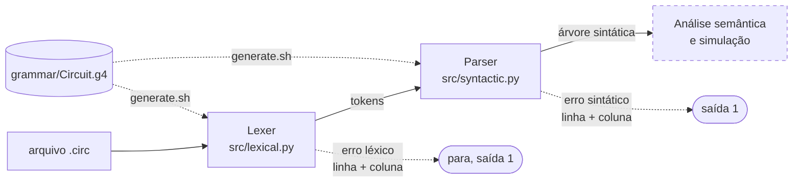

<div align="center">

# Circuit

Uma linguagem pequena para descrever circuitos lógicos combinacionais.<br>Declare sinais, escreva equações booleanas e use um lexer e um parser que apontam o erro com linha e coluna.


[A linguagem](#a-linguagem) ·
[Instalar e rodar](#instalar-e-rodar) ·
[Pipeline](#pipeline) ·
[Precedência](#operadores-e-precedência) ·
[Erros](#relatório-de-erros) ·
[Modo interativo](#modo-interativo) ·
[Testes](#testes) ·
[Status](#status-do-projeto) ·
[Especificação](docs/specification.md)

<a href="README.md">English</a> · <b>Português</b><br>
<sub>Linguagens Formais e Compiladores · projeto do semestre · por Lucas Leal e Jonas Gabriel</sub>

</div>

```bash
pip install -r requirements.txt && bash generate.sh && python src/syntactic.py examples/half_adder.circ
```

---

## A linguagem

`Circuit` descreve **circuitos lógicos combinacionais** em texto. Um programa dá nome ao circuito, declara entradas, saídas e fios internos, e liga tudo com equações booleanas feitas com as portas `AND`, `OR`, `NOT`, `XOR`, `NAND`, `NOR` e `XNOR`. A ideia é ter uma forma escrita e verificável de especificar um circuito, que etapas futuras possam simular.

Um meio somador (`examples/half_adder.circ`):

```
// half adder: adds two bits
circuit "half adder";

input A, B;
output sum, carry;

sum = A XOR B;
carry = A AND B;
```

Um circuito com barramento, índices e parênteses (`examples/bus.circ`):

```
// uses a bus, indices and parentheses
circuit "bus monitor";

input data[4];
output active;

active = (data[0] OR data[1]) AND NOT data[3];
```

Um fio interno e um atraso de propagação (`examples/detector.circ`):

```
// combines three inputs using an intermediate wire
circuit "detector";

input A, B, C;
wire t1;
output S;

t1 = A AND B;
S = t1 OR NOT C @delay 3.0;
```

> [!NOTE]
> As palavras-chave da linguagem (`circuit`, `input`, `output`, `wire`, `delay`) e as portas (`AND`, `OR`...) são em inglês, assim como os exemplos.

### Visão geral

| Elemento | Sintaxe | Significado |
|---|---|---|
| Nome | `circuit "name";` | Dá nome ao circuito |
| Entradas / saídas | `input a, b;` · `output s;` | Sinais externos |
| Sinal interno | `wire t;` | Sinal que não é entrada nem saída |
| Barramento | `data[4]` para declarar, `data[0]` para indexar | Um vetor de bits |
| Ligação | `signal = expression;` | Liga um sinal a uma expressão de portas |
| Atraso | `@delay 2.5` antes do `;` | Atraso de propagação em ns (opcional) |
| Comentário | `// ...` | Descartado pelo analisador |

### O que a linguagem deliberadamente não faz

- **Sem circuitos sequenciais.** Não há memória, flip-flops, clock nem estado: só lógica combinacional.
- **Sem nomes de portas ou palavras-chave como nomes de sinais.** `AND`, `OR`, `NOT`, `input`... são reservados.
- **Sem laços, condicionais, sub-rotinas nem aritmética.** Ela descreve um circuito estático e não é uma linguagem de propósito geral.

A especificação completa, com o exemplo comentado, os tipos e a gramática, está em [docs/specification.md](docs/specification.md) (em inglês).

## Instalar e rodar

Requer Python 3. Na primeira execução, o `antlr4` baixa o Java automaticamente se ele não estiver instalado (responda que sim quando perguntar).

```bash
git clone https://github.com/Luckleal/circuito-lang.git
cd circuito-lang

pip install -r requirements.txt
bash generate.sh

python src/lexical.py examples/half_adder.circ
python src/syntactic.py examples/half_adder.circ
```

O `generate.sh` gera o lexer e o parser em `generated/` a partir de `grammar/Circuit.g4`. Essa pasta não é versionada.

| Programa | O que faz |
|---|---|
| `src/lexical.py` | Lista os tokens reconhecidos e aponta erros léxicos com linha e coluna |
| `src/syntactic.py` | Faz o parsing a partir da regra `program`, imprime a árvore sintática e aponta erros sintáticos com linha e coluna. Se houver erros léxicos, reporta e não faz o parsing |
| `src/interactive.py` | Analisa uma expressão booleana digitada num prompt ([detalhes](#modo-interativo)) |

Códigos de saída dos dois analisadores: `0` sem erros, `1` erros encontrados, `2` erro de uso ou arquivo ilegível.

> [!NOTE]
> A versão do gerador e a do runtime precisam ser a mesma, senão o código gerado pode não rodar. As duas estão fixadas em **4.13.2**: `antlr4-python3-runtime==4.13.2` no `requirements.txt` e `antlr4 -v 4.13.2` no `generate.sh`.

## Pipeline



As duas etapas saem de um único arquivo de gramática. Regras de lexer começam com letra maiúscula e regras de parser com minúscula. A caixa tracejada é a próxima etapa e ainda não existe.

## Operadores e precedência

Do que liga mais forte ao que liga mais fraco:

| Nível | Operadores | Tipo |
|---|---|---|
| 1 | `NOT` | unário |
| 2 | `AND`, `NAND` | binário, associa à esquerda |
| 3 | `OR`, `NOR`, `XOR`, `XNOR` | binário, associa à esquerda |

Parênteses mudam a ordem. A precedência está na ordem das alternativas da regra `expr` na gramática, então `NOT A OR B AND C` é lido como `(NOT A) OR (B AND C)`. O `examples/precedence.circ` mostra isso.

## Relatório de erros

As posições começam em 1 e as mensagens vão para a saída de erro padrão. As mensagens do programa são em inglês.

| Etapa | Problema | Mensagem |
|---|---|---|
| Léxica | Caractere fora da linguagem | `Lexical error at line 4, column 7: invalid character '&'` |
| Léxica | Real sem dígitos depois do ponto | `Lexical error at line 4, column 20: malformed real number '2.' (missing digit after the decimal point)` |
| Léxica | Texto sem aspas de fechamento | `Lexical error at line 1, column 9: unclosed string (missing closing quote)` |
| Sintática | Tokens fora de ordem | `Syntax error at line 5, column 1: found end of file, expected {'@', ';'}` |

A pasta `examples/` guarda os programas usados pelos testes:

```
examples/
├── half_adder.circ   bus.circ   detector.circ   precedence.circ     programas válidos
├── invalid_lexical/   invalid_character · malformed_number · unclosed_string
└── invalid_syntax/    extra_symbol · missing_header · missing_operand
                       missing_semicolon · unclosed_paren
```

## Modo interativo

```bash
python src/interactive.py
```

Ele mostra o prompt `circuit>`. Digite uma expressão booleana e ele exibe os tokens, a árvore sintática e o agrupamento totalmente parentesado, o que deixa a precedência visível. Erros vêm com linha e coluna.

```
circuit> NOT A OR B AND C
Tokens:
  NOT       'NOT'  (column 1)
  ...
Grouped: ((NOT A) OR (B AND C))

circuit> A OR
Syntax error at line 1, column 5: found end of file, expected {'NOT', INT, IDENT, '('}
```

Comandos: `:help` e `:quit` (também `:q`, Ctrl+D ou Ctrl+C). Para analisar uma expressão e sair (código de saída 0 se válida, 1 se não):

```bash
python src/interactive.py "NOT A OR B AND C"
```

## Testes

```bash
python -m pytest
```

202 testes em `tests/`. Eles precisam do `generated/`, então rode `bash generate.sh` antes.

| Arquivo | O que cobre |
|---|---|
| `tests/test_lexer.py` | Tokens, palavras-chave vs identificadores, literais, comentários, posições, os três erros léxicos |
| `tests/test_parser.py` | Programas válidos, precedência e associatividade, parênteses, erros sintáticos com linha e coluna, tradução de mensagens |
| `tests/test_cli.py` | Os dois programas como comandos reais: formato da saída, códigos de saída, stdout vs stderr, arquivo inexistente, qualquer diretório de trabalho, entrada CRLF e não ASCII |
| `tests/test_examples.py` | Cada arquivo de `examples/`, com o resultado esperado e a posição do erro |
| `tests/test_interactive.py` | O analisador interativo: saída, erros, modo de uma expressão e sessões por pipe |

Opções úteis: `python -m pytest -v` (uma linha por teste) e `python -m pytest tests/test_parser.py -k precedence` (um subconjunto).

## Testando a gramática sem gerar código

O `antlr4-parse` interpreta a gramática diretamente. Para ver a árvore de um arquivo inteiro:

```bash
antlr4-parse grammar/Circuit.g4 program -tree examples/precedence.circ
```

O terceiro argumento pode ser qualquer regra, o que permite testar uma regra por vez, por exemplo `expr`:

```bash
echo "NOT A OR B AND C" | antlr4-parse grammar/Circuit.g4 expr -tree
```

## Status do projeto

| Etapa | Entrega | Estado |
|---|---|---|
| E2 | Especificação e analisador léxico | Pronta |
| E3 | Analisador sintático e árvore sintática | Pronta |
| E4 | Análise semântica e execução | Não iniciada |

Ainda não há análise semântica nem simulação. Verificações como declarar antes de usar e restringir constantes a `0` e `1` ficam para a E4 de propósito.

## Estrutura do repositório

```
circuito-lang/
├── README.md · README.pt-BR.md
├── requirements.txt · pytest.ini
├── grammar/Circuit.g4      regras de lexer e de parser
├── generate.sh             regenera o código do ANTLR em generated/
├── src/                    lexical.py · syntactic.py · interactive.py
├── examples/               programas válidos e inválidos
├── tests/                  suíte do pytest
└── docs/
    ├── specification.md    a especificação da linguagem
    └── DIARIO.md           o diário de bordo do grupo
```

## Autores

[Lucas Leal](https://github.com/Luckleal) e [Jonas Gabriel](https://github.com/jonasssgabriel).
