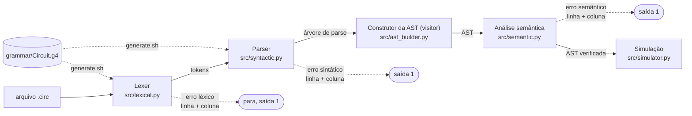

<div align="center">

# Circuit

Uma linguagem pequena para descrever circuitos lógicos combinacionais.<br>Declare sinais, escreva equações booleanas e use um lexer e um parser que apontam o erro com linha e coluna.


[A linguagem](#a-linguagem) ·
[Instalar e rodar](#instalar-e-rodar) ·
[Pipeline](#pipeline) ·
[Precedência](#operadores-e-precedência) ·
[Erros](#relatório-de-erros) ·
[Modo interativo](#modo-interativo) ·
[Interface web](#interface-web) ·
[Testes](#testes) ·
[Status](#status-do-projeto) ·
[Especificação](docs/specification.md)

<a href="README.md">English</a> · <b>Português</b><br>
<sub>Linguagens Formais e Compiladores · projeto do semestre · por Lucas Leal e Jonas Gabriel</sub>

</div>

```bash
pip install -r requirements.txt && bash generate.sh && python src/syntactic.py examples/half_adder.circ
```

---

## A linguagem

`Circuit` descreve **circuitos lógicos combinacionais** em texto. Um programa dá nome ao circuito, declara entradas, saídas e fios internos, e liga tudo com equações booleanas feitas com as portas `AND`, `OR`, `NOT`, `XOR`, `NAND`, `NOR` e `XNOR`. A ideia é ter uma forma escrita e verificável de especificar um circuito, que etapas futuras possam simular.

Um meio somador (`examples/half_adder.circ`):

```
// half adder: adds two bits
circuit "half adder";

input A, B;
output sum, carry;

sum = A XOR B;
carry = A AND B;
```

Um circuito com barramento, índices e parênteses (`examples/bus.circ`):

```
// uses a bus, indices and parentheses
circuit "bus monitor";

input data[4];
output active;

active = (data[0] OR data[1]) AND NOT data[3];
```

Um fio interno e um atraso de propagação (`examples/detector.circ`):

```
// combines three inputs using an intermediate wire
circuit "detector";

input A, B, C;
wire t1;
output S;

t1 = A AND B;
S = t1 OR NOT C @delay 3.0;
```

> [!NOTE]
> As palavras-chave da linguagem (`circuit`, `input`, `output`, `wire`, `delay`) e as portas (`AND`, `OR`...) são em inglês, assim como os exemplos.

### Visão geral

| Elemento | Sintaxe | Significado |
|---|---|---|
| Nome | `circuit "name";` | Dá nome ao circuito |
| Entradas / saídas | `input a, b;` · `output s;` | Sinais externos |
| Sinal interno | `wire t;` | Sinal que não é entrada nem saída |
| Barramento | `data[4]` para declarar, `data[0]` para indexar | Um vetor de bits |
| Ligação | `signal = expression;` | Liga um sinal a uma expressão de portas |
| Atraso | `@delay 2.5` antes do `;` | Atraso de propagação em ns (opcional) |
| Comentário | `// ...` | Descartado pelo analisador |

### O que a linguagem deliberadamente não faz

- **Sem circuitos sequenciais.** Não há memória, flip-flops, clock nem estado: só lógica combinacional.
- **Sem nomes de portas ou palavras-chave como nomes de sinais.** `AND`, `OR`, `NOT`, `input`... são reservados.
- **Sem laços, condicionais, sub-rotinas nem aritmética.** Ela descreve um circuito estático e não é uma linguagem de propósito geral.

A especificação completa, com o exemplo comentado, os tipos e a gramática, está em [docs/specification.md](docs/specification.md) (em inglês).

## Instalar e rodar

Requer Python 3. Na primeira execução, o `antlr4` baixa o Java automaticamente se ele não estiver instalado (responda que sim quando perguntar).

```bash
git clone https://github.com/Luckleal/circuito-lang.git
cd circuito-lang

pip install -r requirements.txt
bash generate.sh

python src/lexical.py examples/half_adder.circ
python src/syntactic.py examples/half_adder.circ
```

O `generate.sh` gera o lexer e o parser em `generated/` a partir de `grammar/Circuit.g4`. Essa pasta não é versionada.

| Programa | O que faz |
|---|---|
| `src/lexical.py` | Lista os tokens reconhecidos e aponta erros léxicos com linha e coluna |
| `src/syntactic.py` | Faz o parsing a partir da regra `program`, imprime a árvore sintática (ou a AST com `--ast`) e aponta erros sintáticos com linha e coluna. Se houver erros léxicos, reporta e não faz o parsing |
| `src/interactive.py` | Analisa uma expressão booleana digitada num prompt ([detalhes](#modo-interativo)) |
| `src/error_strategy.py` | Mensagens de erro sintático (`expected X, found Y`) e recuperação em modo pânico ([detalhes](#relatório-de-erros)) |
| `src/ast_builder.py` | Visitor que transforma a árvore de parse na AST ([detalhes](#árvore-sintática-abstrata-ast)) |
| `src/ast_nodes.py` | As classes dos nós da AST, cada uma com linha e coluna |
| `src/semantic.py` | Análise semântica sobre a AST: tabela de símbolos, checagem de tipos e de quem dirige cada sinal, laços combinacionais ([detalhes](#análise-semântica)) |
| `src/simulator.py` | Simula um programa verificado: tabela-verdade, uma combinação e os tempos a partir das anotações `@delay` ([detalhes](#simulação)) |

Códigos de saída dos dois analisadores: `0` sem erros, `1` erros encontrados, `2` erro de uso ou arquivo ilegível.

> [!NOTE]
> A versão do gerador e a do runtime precisam ser a mesma, senão o código gerado pode não rodar. As duas estão fixadas em **4.13.2**: `antlr4-python3-runtime==4.13.2` no `requirements.txt` e `antlr4 -v 4.13.2` no `generate.sh`.

## Pipeline



O lexer e o parser saem de um único arquivo de gramática. Regras de lexer começam com letra maiúscula e regras de parser com minúscula.

## Árvore sintática abstrata (AST)

A árvore de parse que o ANTLR devolve registra como o parser derivou o programa, então está cheia de andaime da gramática (`statement`, `expr`, `signal`, parênteses, vírgulas). A AST guarda só o que o programa significa, e cada nó carrega sua linha e coluna para as mensagens de erro futuras.

```bash
python src/syntactic.py --ast examples/detector.circ
```

```
Program "detector"
  Declaration input
    Signal A
    ...
  Assignment @delay 3.0
    Signal S
    BinaryOp OR
      Signal t1
      Not
        Signal C
```

A AST é montada por um **visitor**: `src/ast_builder.py` estende a classe `CircuitVisitor` que o ANTLR gera (`-visitor` no `generate.sh`). O visitor é o padrão certo porque cada método devolve o nó que construiu, e um nó pai é feito dos resultados dos filhos. Para isso, cada alternativa da regra `expr` na gramática tem um rótulo (`# NotExpr`, `# AndExpr`, ...), e o ANTLR gera um método `visit...` por rótulo.

| Nó (`src/ast_nodes.py`) | Significado |
|---|---|
| `Program` | O nome do circuito e seus comandos |
| `Declaration` | `input`, `output` ou `wire`, com seus sinais |
| `Assignment` | Um sinal alvo, uma expressão e um atraso opcional |
| `Signal` | Um nome, com largura de barramento (na declaração) ou índice (no uso) |
| `Constant` | `0` ou `1` |
| `Not`, `BinaryOp` | Uma porta com seu operando ou operandos. Os parênteses somem: o formato da árvore já diz o agrupamento |

A AST é bem menor que a árvore de parse: `A OR B AND C` tem 5 nós na AST contra 15 na árvore de parse. A análise semântica percorre essa árvore.

## Análise semântica

A gramática só confere se o programa tem o formato certo. O `src/semantic.py` confere se ele faz sentido: percorre a AST uma vez e reporta **todos** os problemas que encontra (não só o primeiro), com linha e coluna.

```bash
python src/semantic.py examples/full_adder.circ
```

Num programa válido ele imprime a tabela de símbolos e cada equação totalmente parentesada, o que deixa a precedência explícita:

```
Symbol table:
  A      input   bit
  ...
Equations:
  p = (A XOR B)
  sum = (p XOR Cin)
Semantic analysis completed with no errors
```

**Erros** (o programa é rejeitado, saída 1):

| Regra | Exemplo |
|---|---|
| Sinal não declarado | `S = A AND Z;` |
| Sinal usado antes da declaração | `S = A;` acima de `input A;` |
| Sinal declarado duas vezes | `input A; wire A;` |
| Largura de barramento menor que 1 | `input data[0];` |
| Atribuição a uma entrada | `A = B;` |
| Sinal atribuído mais de uma vez | `S = A; S = B;` |
| Índice de barramento fora da faixa | `data[4]` em `data[4]` |
| Índice em algo que não é barramento | `A[0]` com `input A;` |
| Barramento inteiro onde se espera um bit | `S = data AND 1;` |
| Constante diferente de 0 e 1 | `S = A AND 5;` |
| Saída nunca atribuída | `output S, T;` sem nenhum `T = ...` |
| Wire lido mas nunca atribuído | `wire t;` usado em `S = A AND t;` |
| Laço combinacional | `x = y AND A; y = x OR A;` |

**Avisos** (reportados, mas o programa é aceito, saída 0): uma entrada que nunca é usada, e um wire declarado ou atribuído mas nunca usado.

Como funciona: toda porta produz um bit, então a única regra de tipo é que cada operando seja um bit; um barramento inteiro ou um índice inválido é rejeitado onde aparece. Cada bit de um barramento é acompanhado separadamente, então `y[0] = y[1]` é válido, mas `y[0] = y[1]; y[1] = y[0]` é um laço. Os laços são achados com uma busca em profundidade sobre "quais sinais este lê". Se o lexer ou o parser reportarem erro, a etapa semântica não roda. A pasta `examples/invalid_semantic/` tem um arquivo para cada erro.

## Operadores e precedência

Do que liga mais forte ao que liga mais fraco:

| Nível | Operadores | Tipo |
|---|---|---|
| 1 | `NOT` | unário |
| 2 | `AND`, `NAND` | binário, associa à esquerda |
| 3 | `OR`, `NOR`, `XOR`, `XNOR` | binário, associa à esquerda |

Parênteses mudam a ordem. A precedência está na ordem das alternativas da regra `expr` na gramática, então `NOT A OR B AND C` é lido como `(NOT A) OR (B AND C)`. O `examples/precedence.circ` mostra isso.

## Relatório de erros

As posições começam em 1 e as mensagens vão para a saída de erro padrão. As mensagens do programa são em inglês.

| Etapa | Problema | Mensagem |
|---|---|---|
| Léxica | Caractere fora da linguagem | `Lexical error at line 4, column 7: invalid character '&'` |
| Léxica | Real sem dígitos depois do ponto | `Lexical error at line 4, column 20: malformed real number '2.' (missing digit after the decimal point)` |
| Léxica | Texto sem aspas de fechamento | `Lexical error at line 1, column 9: unclosed string (missing closing quote)` |
| Sintática | Tokens fora de ordem | `Syntax error at line 5, column 1: expected '@' or ';', found end of file` |

**As mensagens de erro sintático** sempre trazem as três coisas que tornam uma mensagem útil: onde (linha e coluna), o que o parser esperava e o que encontrou, no formato `expected X, found Y`. A mensagem é montada a partir do token que causou o erro e do conjunto de tokens que seriam aceitos ali, com nomes legíveis (`an expression`, `identifier`, `';'`), e não a partir do texto do próprio ANTLR.

**Recuperação (modo pânico).** Depois de um erro sintático, o parser descarta tokens até um ponto seguro e recomeça dali, então um erro dá **uma** mensagem e todo erro real do arquivo continua sendo reportado. Sem isso, um erro deixa o parser no meio de um comando lido pela metade e tudo depois parece errado: nos nossos testes, 3 comandos quebrados davam 5 mensagens (2 delas fantasmas) antes, e dão exatamente 3 agora. Os pontos seguros são os tokens que só aparecem no fim ou no começo de um comando: `;`, e `input`, `output` ou `wire` quando um identificador vem depois. Nunca `AND`, `OR` ou `,`, que aparecem no meio dos comandos. Um `;` também nunca é descartado como token "sobrando", porque isso colaria o próximo comando no quebrado e esconderia os erros dele. A lógica está em `src/error_strategy.py`.

A pasta `examples/` guarda os programas usados pelos testes:

```
examples/
├── half_adder.circ   full_adder.circ   bus.circ   detector.circ   precedence.circ   delays.circ     programas válidos
├── invalid_lexical/   invalid_character · malformed_number · unclosed_string
└── invalid_syntax/    extra_symbol · missing_header · missing_operand
                       missing_semicolon · unclosed_paren
```

## Simulação

O `src/simulator.py` executa um programa já verificado. Um programa válido é um circuito combinacional estático, então pode ser calculado porta por porta, na ordem das dependências.

```bash
python src/simulator.py examples/half_adder.circ
```

```
Truth table of "half adder": 2 input bits, 4 rows
A B | sum carry
0 0 |  0    0
0 1 |  1    0
1 0 |  1    0
1 1 |  0    1
```

Para calcular **uma** combinação, dê um valor para cada bit de entrada (um bit de barramento se escreve `data[2]=1`):

```bash
python src/simulator.py examples/full_adder.circ A=1 B=1 Cin=0
```

```
Inputs:
  A = 1
  B = 1
  Cin = 0
Wires:
  p = 0
  g1 = 1
  g2 = 0
Outputs:
  sum = 0
  carry = 1
```

Como funciona:

- O lexer, o parser e a análise semântica rodam antes, e a simulação para em qualquer erro (saída 1, `simulation not run`). É isso que torna o cálculo seguro: toda saída é dirigida, nenhum sinal depende de si mesmo e todo bit tem valor definido.
- Cada bit dirigido é calculado uma vez, depois dos bits que ele lê. `NAND`, `NOR` e `XNOR` são as negações de `AND`, `OR` e `XOR`.
- Na tabela-verdade a primeira entrada é o bit mais significativo, então as linhas contam em binário. As colunas são as entradas e depois as saídas, na ordem de declaração, com o barramento mostrado bit a bit (`data[0]`, `data[1]`, ...).
- Uma tabela tem 2^n linhas, então é limitada a 16 bits de entrada (65.536 linhas). Acima disso, dê um valor para cada entrada para calcular uma combinação.
- Se falta um valor, se ele não é 0 nem 1, ou se o nome não é um bit de entrada, o simulador avisa e sai com código 2.

**Tempos.** Quando o programa tem anotações `@delay`, o simulador também informa quando cada saída se estabiliza. O tempo de chegada de um sinal é o maior tempo de chegada entre os sinais que ele lê, mais o atraso dele, e as entradas chegam em 0. O caminho crítico é a rota de uma entrada até a saída mais lenta. Num empate, aparece a rota que passa por mais portas. O `examples/delays.circ` mostra isso:

```
Timing (ns):
  S  4.0
  T  1.0
Critical path: A -> x -> y -> S (4.0 ns)
```

Códigos de saída: `0` simulado, `1` o programa tem erros, `2` erro de uso, arquivo ilegível, valores inválidos ou entradas demais para uma tabela.

## Modo interativo

```bash
python src/interactive.py
```

Ele mostra o prompt `circuit>`. Digite uma expressão booleana e ele exibe os tokens, a árvore sintática, a AST e o agrupamento totalmente parentesado, o que deixa a precedência visível. Erros vêm com linha e coluna.

```
circuit> NOT A OR B AND C
Tokens:
  NOT       'NOT'  (column 1)
  ...
Grouped: ((NOT A) OR (B AND C))

circuit> A OR
Syntax error at line 1, column 5: expected an expression, found end of file
```

Comandos: `:help` e `:quit` (também `:q`, Ctrl+D ou Ctrl+C). Para analisar uma expressão e sair (código de saída 0 se válida, 1 se não):

```bash
python src/interactive.py "NOT A OR B AND C"
```

## Interface web

Uma interface web local usa o compilador de verdade: escreva ou importe um programa `.circ`, analise e veja os tokens, a árvore sintática concreta, a AST, o circuito desenhado com os símbolos das portas, a avaliação passo a passo e a tabela-verdade. Funciona no computador e no celular e segue o idioma do navegador (português, inglês, espanhol, francês, alemão, chinês, japonês), que pode ser trocado no cabeçalho.

**Modo rápido:** digite só uma expressão como `A OR B` e a interface monta um programa Circuit completo (`circuit "expression"; input A, B; output S; S = A OR B;`), compila pelo mesmo pipeline e mostra o circuito, a animação, a tabela-verdade e a análise escrita. O programa gerado fica sempre visível e pode ser aberto no modo **Programa completo**, que é a linguagem e o compilador inteiros.

```bash
python src/server.py        # depois abra http://127.0.0.1:8765/
```

O servidor escuta só em `127.0.0.1` e não precisa de nada além do `requirements.txt`. Ele chama `lexical.py`, `syntactic.py`, `ast_builder.py`, `semantic.py` e `simulator.py` por meio de `src/api.py`, então a linha de comando e a interface usam as mesmas regras. Os programas só são analisados, nunca executados.

> [!NOTE]
> A árvore sintática concreta, a AST e o circuito são coisas diferentes: a primeira é como o parser derivou o texto, a segunda guarda só o que o programa significa, a terceira é a rede de portas e fios. A animação passo a passo mostra a ordem de avaliação de um circuito combinacional; não é uma simulação temporal. O `@delay` segue a regra da seção [Simulação](#simulação). A tabela-verdade ajuda a conferir o comportamento; não prova que o compilador está correto.

No VS Code, aperte F5 e escolha **Circuit: web interface**. As outras configurações rodam o simulador, a análise semântica e a AST no arquivo atual. Uma extensão mínima de realce para `.circ` está em `vscode/circuit-language/`.

## Testes

```bash
python -m pytest
```

202 testes em `tests/`. Eles precisam do `generated/`, então rode `bash generate.sh` antes.

| Arquivo | O que cobre |
|---|---|
| `tests/test_lexer.py` | Tokens, palavras-chave vs identificadores, literais, comentários, posições, os três erros léxicos |
| `tests/test_parser.py` | Programas válidos, precedência e associatividade, parênteses, erros sintáticos com linha e coluna, tradução de mensagens |
| `tests/test_cli.py` | Os dois programas como comandos reais: formato da saída, códigos de saída, stdout vs stderr, arquivo inexistente, qualquer diretório de trabalho, entrada CRLF e não ASCII |
| `tests/test_examples.py` | Cada arquivo de `examples/`, com o resultado esperado e a posição do erro |
| `tests/test_interactive.py` | O analisador interativo: saída, erros, modo de uma expressão e sessões por pipe |
| `tests/test_ast.py` | A AST e seu visitor: tipos de nó, formato da precedência, posições, impressão, opção `--ast` |
| `tests/test_recovery.py` | Recuperação em modo pânico: uma mensagem por erro em 20 cenários, sem erros fantasma, um token danificado nunca dá mais de uma mensagem, entrada aleatória sempre termina |
| `tests/test_semantic.py` | Cada regra semântica com sua linha e coluna, avisos, laços, tabela de símbolos, equações e a linha de comando |
| `tests/test_simulator.py` | Cada porta, os circuitos de exemplo, um avaliador independente em expressões aleatórias (com e sem parênteses), tempos e caminho crítico, valores dados na linha de comando e o limite de tamanho |

Opções úteis: `python -m pytest -v` (uma linha por teste) e `python -m pytest tests/test_parser.py -k precedence` (um subconjunto).

## Testando a gramática sem gerar código

O `antlr4-parse` interpreta a gramática diretamente. Para ver a árvore de um arquivo inteiro:

```bash
antlr4-parse grammar/Circuit.g4 program -tree examples/precedence.circ
```

O terceiro argumento pode ser qualquer regra, o que permite testar uma regra por vez, por exemplo `expr`:

```bash
echo "NOT A OR B AND C" | antlr4-parse grammar/Circuit.g4 expr -tree
```

## Status do projeto

| Etapa | Entrega | Estado |
|---|---|---|
| E2 | Especificação e analisador léxico | Pronta |
| E3 | Analisador sintático, árvore sintática e AST (montada com o visitor) | Pronta |
| E4 | Análise semântica e execução | Pronta |

A análise semântica e a simulação estão completas. A interface web local desenha o circuito com os símbolos das portas e anima a avaliação (veja [Interface web](#interface-web)).

## Estrutura do repositório

```
circuito-lang/
├── README.md · README.pt-BR.md
├── requirements.txt · pytest.ini
├── grammar/Circuit.g4      regras de lexer e de parser
├── generate.sh             regenera o código do ANTLR em generated/
├── web/                    interface web local (HTML, CSS, módulos JS)
├── vscode/                 extensão mínima do VS Code para .circ
├── src/                    api.py · server.py · lexical.py · syntactic.py · interactive.py · ast_nodes.py · ast_builder.py · semantic.py · error_strategy.py · simulator.py
├── examples/               programas válidos e inválidos
├── tests/                  suíte do pytest
└── docs/
    ├── specification.md    a especificação da linguagem
    └── DIARIO.md           o diário de bordo do grupo
```

## Autores

[Lucas Leal](https://github.com/Luckleal) e [Jonas Gabriel](https://github.com/jonasssgabriel).
