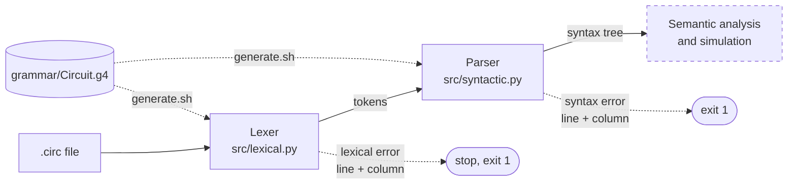

<div align="center">

# Circuit

A small language for describing combinational logic circuits.<br>Declare signals, write boolean equations, and get a lexer and parser with precise error positions.


[The language](#the-language) ·
[Install and run](#install-and-run) ·
[Pipeline](#pipeline) ·
[Precedence](#operators-and-precedence) ·
[Errors](#error-reporting) ·
[Interactive mode](#interactive-mode) ·
[Tests](#tests) ·
[Status](#project-status) ·
[Specification](docs/specification.md)

<sub>Formal Languages and Compilers · semester project · by Lucas Leal and Jonas Gabriel</sub>

</div>

```bash
pip install -r requirements.txt && bash generate.sh && python src/syntactic.py examples/half_adder.circ
```

---

## The language

`Circuit` describes **combinational logic circuits** in text. A program names the circuit, declares its inputs, outputs and internal wires, and connects them with boolean equations built from the gates `AND`, `OR`, `NOT`, `XOR`, `NAND`, `NOR` and `XNOR`. The goal is a written, checkable way to specify a circuit, which later stages can simulate.

A half adder (`examples/half_adder.circ`):

```
// half adder: adds two bits
circuit "half adder";

input A, B;
output sum, carry;

sum = A XOR B;
carry = A AND B;
```

A circuit with a bus, indices and parentheses (`examples/bus.circ`):

```
// uses a bus, indices and parentheses
circuit "bus monitor";

input data[4];
output active;

active = (data[0] OR data[1]) AND NOT data[3];
```

An internal wire and a propagation delay (`examples/detector.circ`):

```
// combines three inputs using an intermediate wire
circuit "detector";

input A, B, C;
wire t1;
output S;

t1 = A AND B;
S = t1 OR NOT C @delay 3.0;
```

### At a glance

| Element | Syntax | Meaning |
|---|---|---|
| Name | `circuit "name";` | Names the circuit |
| Inputs / outputs | `input a, b;` · `output s;` | External signals |
| Internal signal | `wire t;` | A signal that is neither input nor output |
| Bus | `data[4]` to declare, `data[0]` to index | A vector of bits |
| Connection | `signal = expression;` | Wires a signal to a gate expression |
| Delay | `@delay 2.5` before the `;` | Propagation delay in ns (optional) |
| Comment | `// ...` | Discarded by the analyzer |

### What the language deliberately does not do

- **No sequential circuits.** No memory, flip-flops, clock or state: only combinational logic.
- **No gate names or keywords as signal names.** `AND`, `OR`, `NOT`, `input`... are reserved.
- **No loops, conditionals, subroutines or arithmetic.** It describes a static circuit and is not a general-purpose language.

The full specification, with the commented example, types and grammar, is in [docs/specification.md](docs/specification.md).

## Install and run

Requires Python 3. The first run of `antlr4` downloads Java automatically if it is missing (answer yes when asked).

```bash
git clone https://github.com/Luckleal/circuito-lang.git
cd circuito-lang/circuito-lang

pip install -r requirements.txt
bash generate.sh

python src/lexical.py examples/half_adder.circ
python src/syntactic.py examples/half_adder.circ
```

`generate.sh` builds the lexer and parser into `generated/` from `grammar/Circuit.g4`. That folder is not versioned.

| Program | What it does |
|---|---|
| `src/lexical.py` | Lists the recognized tokens and reports lexical errors with line and column |
| `src/syntactic.py` | Parses from the `program` rule, prints the syntax tree and reports syntax errors with line and column. If there are lexical errors it reports them and does not parse |
| `src/interactive.py` | Analyzes a boolean expression typed at a prompt ([details](#interactive-mode)) |

Exit codes of both analyzers: `0` no errors, `1` errors found, `2` usage error or unreadable file.

> [!NOTE]
> The generator and the runtime must be the same version, otherwise the generated code may not run. Both are pinned to **4.13.2**: `antlr4-python3-runtime==4.13.2` in `requirements.txt` and `antlr4 -v 4.13.2` in `generate.sh`.

## Pipeline



Both stages come from a single grammar file. Lexer rules start with an uppercase letter and parser rules with a lowercase one. The dashed box is the next stage and does not exist yet.

## Operators and precedence

From the tightest binding to the loosest:

| Level | Operators | Kind |
|---|---|---|
| 1 | `NOT` | unary |
| 2 | `AND`, `NAND` | binary, left-associative |
| 3 | `OR`, `NOR`, `XOR`, `XNOR` | binary, left-associative |

Parentheses change the order. The precedence lives in the order of the alternatives of the `expr` rule in the grammar, so for example `NOT A OR B AND C` is read as `(NOT A) OR (B AND C)`. `examples/precedence.circ` shows it.

## Error reporting

Positions are 1-based and messages go to the standard error stream.

| Stage | Problem | Message |
|---|---|---|
| Lexical | Character outside the language | `Lexical error at line 4, column 7: invalid character '&'` |
| Lexical | Real number without digits after the point | `Lexical error at line 4, column 20: malformed real number '2.' (missing digit after the decimal point)` |
| Lexical | String without the closing quote | `Lexical error at line 1, column 9: unclosed string (missing closing quote)` |
| Syntactic | Tokens in the wrong order | `Syntax error at line 5, column 1: found end of file, expected {'@', ';'}` |

The `examples/` folder holds the programs the tests run on:

```
examples/
├── half_adder.circ   bus.circ   detector.circ   precedence.circ     valid programs
├── invalid_lexical/   invalid_character · malformed_number · unclosed_string
└── invalid_syntax/    extra_symbol · missing_header · missing_operand
                       missing_semicolon · unclosed_paren
```

## Interactive mode

```bash
python src/interactive.py
```

It prompts with `circuit>`. Type a boolean expression and it shows the tokens, the syntax tree and the fully parenthesized grouping, which makes the precedence visible. Errors come with line and column.

```
circuit> NOT A OR B AND C
Tokens:
  NOT       'NOT'  (column 1)
  ...
Grouped: ((NOT A) OR (B AND C))

circuit> A OR
Syntax error at line 1, column 5: found end of file, expected {'NOT', INT, IDENT, '('}
```

Commands: `:help` and `:quit` (also `:q`, Ctrl+D or Ctrl+C). To analyze one expression and exit (exit code 0 if valid, 1 if not):

```bash
python src/interactive.py "NOT A OR B AND C"
```

## Tests

```bash
python -m pytest
```

81 tests in `tests/`. They need `generated/`, so run `bash generate.sh` first.

| File | What it covers |
|---|---|
| `tests/test_lexer.py` | Tokens, keywords vs identifiers, literals, comments, positions, the three lexical errors |
| `tests/test_parser.py` | Valid programs, precedence and associativity, parentheses, syntax errors with line and column, message translation |
| `tests/test_cli.py` | Both programs as real commands: output format, exit codes, stdout vs stderr, missing file, any working directory, CRLF and non-ASCII input |
| `tests/test_examples.py` | Every file in `examples/`, with the expected result and error position |
| `tests/test_interactive.py` | The interactive analyzer: output, errors, one-shot mode and piped sessions |

Useful options: `python -m pytest -v` (one line per test) and `python -m pytest tests/test_parser.py -k precedence` (a subset).

## Testing the grammar without generating code

`antlr4-parse` interprets the grammar directly. To see the tree of a whole file:

```bash
antlr4-parse grammar/Circuit.g4 program -tree examples/precedence.circ
```

The third argument can be any rule, which allows testing one rule at a time, for example `expr`:

```bash
echo "NOT A OR B AND C" | antlr4-parse grammar/Circuit.g4 expr -tree
```

## Project status

| Stage | Delivers | State |
|---|---|---|
| E2 | Specification and lexical analyzer | Done |
| E3 | Syntactic analyzer and syntax tree | Done |
| E4 | Semantic analysis and execution | Not started |

There is no semantic analysis or simulation yet. Checks such as declare-before-use and restricting constants to `0` and `1` are left to E4 on purpose.

## Repository layout

```
circuito-lang/
├── grammar/Circuit.g4      lexer and parser rules
├── generate.sh             regenerates the ANTLR code into generated/
├── src/                    lexical.py · syntactic.py · interactive.py
├── examples/               valid and invalid programs
├── tests/                  pytest suite
└── docs/
    ├── specification.md    the language specification
    └── DIARIO.md           the team's work log
```

## Authors

[Lucas Leal](https://github.com/Luckleal) and [Jonas Gabriel](https://github.com/jonasssgabriel).
